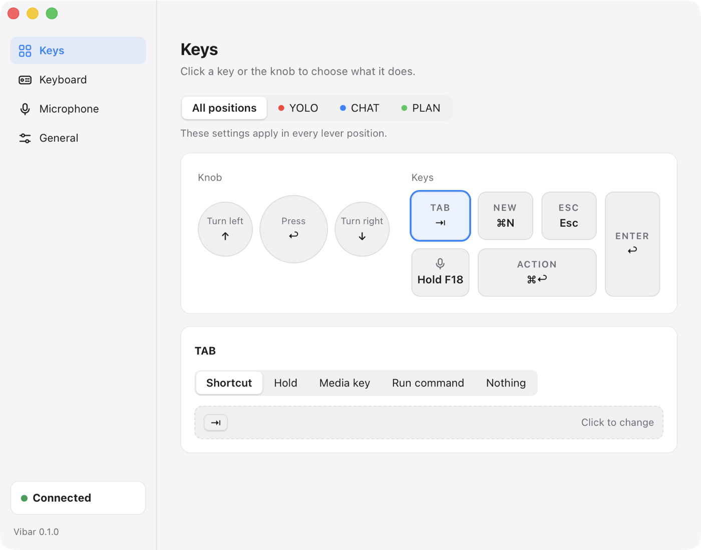

# Vibar

**Unofficial macOS menu bar client for the ReAI-Vibe-Board keyboard.**
Connect it over Bluetooth and remap every knob, key and mode lever, without the vendor app.

[](LICENSE)


English | [简体中文](README.zh-CN.md)

<p align="center">
  
</p>

> **Vibar is a community project and is not affiliated with ReAI.**
> "ReAI", "ReAI-Vibe-Board" and related names belong to their owners and are used only to say which hardware Vibar works with.
> The interface comes in English and Chinese. It follows the system language and can be changed in Settings → General.

## Quick start

Needs macOS 12+, [Rust](https://rustup.rs) 1.87+ and `cmake` (`brew install cmake`, it builds the virtual microphone driver). There is no public release yet. `scripts/dmg.sh` builds a disk image, see [docs/releasing.md](docs/releasing.md) for what is still missing before one can be shared widely.

```bash
git clone https://github.com/koalaauto/reaiboard-vibar.git
cd reaiboard-vibar
scripts/bundle.sh --run      # builds build/Vibar.app and launches it
```

Then:

1. **Unplug the USB cable.** The keyboard does not advertise Bluetooth while it is plugged in.
2. **Press any key** to wake it. The menu bar icon turns solid when it is connected.
3. Allow **Bluetooth** when macOS asks, and **Accessibility** when the menu shows *Accessibility permission needed…*.
4. Open the menu bar icon → **Settings…** to change the keys. On the very first launch the settings window opens by itself with a two-step *Get started* checklist (Accessibility, keyboard connected) that ticks off as you go and then disappears.

> **Do not pair the keyboard in System Settings → Bluetooth.** Over Bluetooth it is not a normal keyboard, and a system-paired one keeps its connection to macOS and stops advertising, so Vibar cannot find it. If you already paired it, remove it there first. Also quit the vendor app: only one program can hold the keyboard.

## Features

- **Bluetooth direct connection**, reconnects by itself after the keyboard sleeps
- **Remap everything**: 3 knob inputs (counter-clockwise, clockwise, press) and 6 keys to a shortcut, hold-to-talk, media key, shell command, or nothing
- **Three layers, one per lever position.** Set defaults once, override only what differs in CHAT, YOLO or PLAN, and run an action when the lever enters or leaves a position
- **Settings window with a live view**: press a real key and it lights up on screen
- **Sleep time** of the keyboard, changeable (the factory 10 minutes is short)
- **Keyboard as a system microphone** through a virtual audio device, open only while an app records
- **Hand the keyboard to another computer** with one click
- **English and Chinese interface**, following the system language
- Menu bar only, light and dark mode, optional launch at login

### Default layout

| Input | Default |
|---|---|
| Knob counter-clockwise / clockwise / press | `↑` / `↓` / `Return` |
| Tab, New, Esc, Action, Enter | `Tab`, `⌘N`, `Esc`, `⌘Return`, `Return` |
| Voice key | hold `F18` |

Set your push-to-talk or dictation tool to **hold F18** and the voice key becomes a talk button. Everything is stored in one TOML file: [docs/configuration.md](docs/configuration.md).

## Using the keyboard on more than one computer

The keyboard connects to **one computer at a time**. While it is connected to yours it stops advertising, so another computer cannot see it. To hand it over:

1. On the computer that has it, choose **Disconnect Keyboard** in the menu, or quit Vibar. Vibar then stops reconnecting by itself.
2. Press any key on the keyboard so it wakes up and advertises again.
3. On the other computer, open Vibar. It finds the keyboard and connects. If it has not found it after about 15 seconds, it says the keyboard may be held by another computer.

To take it back, do the same the other way round. The keyboard must not be paired in System Settings → Bluetooth on either computer. *Hand-over has not been tested with two computers yet.*

## Status

Version **0.1.0**, macOS only. Tested on one unit: macOS 26.6, Apple Silicon, keyboard firmware 1.75, Bluetooth.

**Verified on hardware**

- Scan, connect, and the full event stream (knob, keys, lever)
- Reconnect after the keyboard sleeps
- A key press becoming a system action (knob to system volume)
- Reading and writing the sleep time
- Installing the virtual microphone driver

**Not verified yet**

- Per-lever-position layers on hardware
- Knob direction calibration
- Microphone audio reaching a recording app
- Handing the keyboard to a second computer
- Launch at login

Intel Macs and other firmware versions are untested. Reports are welcome.

## The keyboard

The [ReAI-Vibe-Board](https://ai-board.reai.com/en) (also written *ReAI Vibe Board*, *REAI Vibe Board* or *AI-Board*) is a voice-first mechanical keyboard with a metal knob, six keys, dual microphones and a physical **3-position lever, CHAT / PLAN / YOLO**, meant as an AI permission switch. It connects by USB-C or Bluetooth and has an open SDK, [`ReAI-com/reai-board-sdk`](https://github.com/ReAI-com/reai-board-sdk).

<p align="center">
  
  <br>
  <sub>Product photo © ReAI, linked from the <a href="https://ai-board.reai.com/en">official site</a>.</sub>
</p>

| | |
|---|---|
| USB | vendor id `0x363C`, product id `0xED20`, product string `REAI Vibe Board` |
| Bluetooth | advertises as `REAI_VB_xxxxxxxx`, vendor GATT service `FE60`–`FE63` |

**Why Vibar exists.** Over Bluetooth the keyboard talks through a vendor-specific GATT service, not as a standard Bluetooth keyboard. Something has to subscribe to its notifications and turn knob turns, key presses and lever moves into real actions. The vendor ships a desktop app for that. Vibar is a small, open, hackable alternative built on the vendor's MIT-licensed SDK. More in [docs/hardware.md](docs/hardware.md).

## Permissions and signing

Vibar needs **Bluetooth** (to talk to the keyboard) and **Accessibility** (to press keys for you). macOS remembers a permission by bundle id plus code signature. `scripts/bundle.sh` signs with the first code-signing identity in your keychain and falls back to ad-hoc signing, and **an ad-hoc signature changes on every build, so you grant the permissions again after each rebuild**. How to avoid that: [docs/signing-and-permissions.md](docs/signing-and-permissions.md).

## Troubleshooting

| Symptom | Likely cause and fix |
|---|---|
| Menu stays on *Searching for the keyboard…* | The keyboard is asleep (press a key), a USB cable is plugged in, it is paired in System Settings → Bluetooth (remove it there), or another program or computer holds it (quit it, or use *Disconnect Keyboard* on that computer). |
| Keys do nothing | Accessibility is not granted. The menu shows an *Accessibility permission needed…* row until it is. |
| Asked for permissions after every build | Ad-hoc signing, see [docs/signing-and-permissions.md](docs/signing-and-permissions.md). |
| The binary is killed as soon as it touches Bluetooth | You ran it from a terminal or IDE. Run `build/Vibar.app` instead. |
| Knob goes the wrong way | Settings → Keyboard → Calibrate, or set `knob_swap = true` in the config. |
| No `ReAI-Vibe-Board` input in System Settings → Sound | Enable it in Settings → Microphone (an administrator password is needed). If it still does not show, use Uninstall and enable it again. |
| Something else is wrong | Settings → General → *Log file* → *Show in Finder*, and attach `vibar.log` to your report. It lives in `~/Library/Logs/Vibar/`, keeps the last 2 MB, and holds input names and connection events, never typed text. Glance at it first: a shell command from your config that fails to start is logged with its command line. |

## Uninstall

1. In Vibar: Settings → Microphone → **Uninstall** to remove the audio driver, and switch off launch at login. Then quit Vibar and delete `Vibar.app`.
2. Remove settings and logs: `rm -rf ~/.config/vibar ~/Library/Logs/Vibar`.
3. If the driver is still listed: `sudo rm -rf /Library/Audio/Plug-Ins/HAL/ReAIVibeBoard.driver && sudo killall coreaudiod`.
4. If launch at login was on: `rm ~/Library/LaunchAgents/dev.koala.vibar.plist`.

## Documentation

| | |
|---|---|
| [docs/architecture.md](docs/architecture.md) | Modules, threads, data flow. Start here to change code. |
| [docs/configuration.md](docs/configuration.md) | Config file reference |
| [docs/hardware.md](docs/hardware.md) | What we learned about the keyboard: inputs, Bluetooth behavior, sleep, microphone |
| [docs/design-principles.md](docs/design-principles.md) | UI copy and icon rules |
| [docs/signing-and-permissions.md](docs/signing-and-permissions.md) | Code signing and permissions |
| [docs/releasing.md](docs/releasing.md) | Disk image, who can open it, release checklist |
| [CHANGELOG.md](CHANGELOG.md) | What changed |
| [CONTRIBUTING.md](CONTRIBUTING.md) | Setup, local CI, conventions |
| [AGENTS.md](AGENTS.md) | Guide for AI coding agents working in this repo |

## Safety

Apart from the **sleep time** that you change yourself, Vibar only reads from the keyboard. It never touches key configuration, firmware update or factory commands. Installing the virtual microphone needs an administrator password and restarts `coreaudiod`, so system audio drops for a second or two. You are asked first, and you can remove the driver any time.

## Acknowledgements and license

- [`reai-board-sdk`](https://github.com/ReAI-com/reai-board-sdk) by ReAI (MIT) does the Bluetooth and protocol work. Its `msbc-decoder` is **LGPL-2.1-or-later**, see [THIRD_PARTY_NOTICES.md](THIRD_PARTY_NOTICES.md).
- Built with [tao](https://github.com/tauri-apps/tao), [wry](https://github.com/tauri-apps/wry), [tray-icon](https://github.com/tauri-apps/tray-icon), [enigo](https://github.com/enigo-rs/enigo).

Vibar itself is released under the [MIT License](LICENSE).
