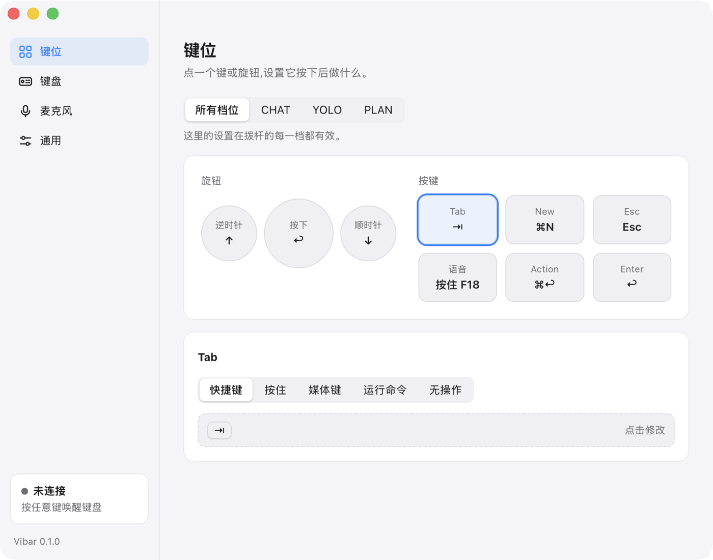

# Vibar

**ReAI-Vibe-Board 键盘的非官方 macOS 菜单栏客户端。**
蓝牙直连键盘,重新映射每一个旋钮、按键和模式拨杆,不需要官方 App。

[](LICENSE)


[English](README.md) | 简体中文

<p align="center">
  
</p>

> **Vibar 是社区项目,与 ReAI 公司没有隶属关系。**
> "ReAI"、"ReAI-Vibe-Board" 等名称归其各自所有者,这里只用来说明 Vibar 适配的硬件。

## 快速开始

需要 macOS 12 以上、[Rust](https://rustup.rs) 1.87 以上、`cmake`(`brew install cmake`,用来编译虚拟麦克风驱动)。暂时没有公开发布的版本。`scripts/dmg.sh` 可以打出磁盘映像,广泛分发前还缺什么见 [docs/releasing.md](docs/releasing.md)。

```bash
git clone https://github.com/koalaauto/reaiboard-vibar.git
cd reaiboard-vibar
scripts/bundle.sh --run      # 构建 build/Vibar.app 并启动
```

然后:

1. **拔掉 USB 线。** 键盘插着 USB 时不会广播蓝牙。
2. **按任意键**唤醒键盘,连上后菜单栏图标变成实心。
3. macOS 询问时允许**蓝牙**;菜单里出现「需要辅助功能权限…」时,去授权**辅助功能**。
4. 点菜单栏图标 → **设置…**,修改键位。第一次启动时设置窗口会自己打开,顶部有「开始使用」两步清单(允许辅助功能、连上键盘),做完一步打一个对勾,全部完成后消失。

> **不要在「系统设置 → 蓝牙」里配对这块键盘。** 走蓝牙时它不是普通键盘,配过对的键盘会一直连着系统、不再广播,Vibar 就找不到它。已经配过的话,先在那里移除。同时请退出官方 App,同一时间只有一个程序能占用键盘。

## 功能

- **蓝牙直连**,键盘休眠后自动重连
- **全部可重新映射**:旋钮三个输入(逆时针、顺时针、按下)和 6 个按键,可设为快捷键、按住说话、媒体键、命令或无操作
- **三层绑定,对应拨杆三档。** 先设一套默认,再只覆盖 CHAT、YOLO、PLAN 里不同的键,还能在拨杆拨入或拨出时触发动作
- **设置窗口带实时显示**:按下真实的键,窗口里对应位置会亮起来
- **键盘休眠时间**可以修改,出厂的 10 分钟偏短
- **把键盘用作系统麦克风**,通过虚拟音频设备实现,只在有 App 录音时才打开
- **一键把键盘让给另一台电脑**
- **中英文界面**,跟随系统语言,可在 设置 → 通用 里切换
- 只有菜单栏,支持深色模式,可开机自启

### 默认键位

| 输入 | 默认 |
|---|---|
| 旋钮 逆时针 / 顺时针 / 按下 | `↑` / `↓` / `Return` |
| Tab、New、Esc、Action、Enter | `Tab`、`⌘N`、`Esc`、`⌘Return`、`Return` |
| 语音键 | 按住 `F18` |

把你的语音输入工具的按住说话快捷键设成 **按住 F18**,语音键就成了说话键。所有设置保存在一个 TOML 文件里:[docs/configuration.md](docs/configuration.md)。

## 在多台电脑上使用同一块键盘

键盘**同一时间只连一台电脑**。它连着你的电脑时会停止广播,别的电脑就看不到它。要交给别人:

1. 在现在连着的那台电脑上,点菜单里的**断开键盘**,或者直接退出 Vibar。之后 Vibar 不会再自动重连。
2. 在键盘上按任意键,让它醒来并重新广播。
3. 在另一台电脑上打开 Vibar,它会找到键盘并连上。如果大约 15 秒还没找到,它会提示键盘可能被别的电脑占着。

要拿回来就反过来操作一遍。两台电脑的「系统设置 → 蓝牙」里都不能配对过这块键盘。*让给第二台电脑这一步还没有用两台电脑实测过。*

## 状态

版本 **0.1.0**,仅 macOS。在一台设备上测试过:macOS 26.6、Apple Silicon、键盘固件 1.75、蓝牙。

**真机验证过**

- 扫描、连接,以及完整的事件流(旋钮、按键、拨杆)
- 键盘休眠后重连
- 按键变成系统操作(旋钮控制系统音量)
- 读取和修改休眠时间
- 安装虚拟麦克风驱动

**尚未验证**

- 拨杆分层在真机上的效果
- 旋钮方向校准
- 麦克风声音进入录音 App
- 把键盘让给第二台电脑
- 开机自启

Intel Mac 和其他固件版本没有测过,欢迎反馈。

## 这块键盘

[ReAI-Vibe-Board](https://ai-board.reai.com/en)(也写作 ReAI Vibe Board、REAI Vibe Board、AI-Board)是一块语音优先的机械键盘:金属旋钮、6 个按键、双麦克风,以及一个实体**三段拨杆 CHAT / PLAN / YOLO**,定位是 AI 权限开关。支持 USB-C 和蓝牙,有开放 SDK [`ReAI-com/reai-board-sdk`](https://github.com/ReAI-com/reai-board-sdk)。

<p align="center">
  
  <br>
  <sub>产品图 © ReAI,链接自<a href="https://ai-board.reai.com/en">官网</a>。</sub>
</p>

| | |
|---|---|
| USB | vendor id `0x363C`,product id `0xED20`,产品名 `REAI Vibe Board` |
| 蓝牙 | 广播名 `REAI_VB_xxxxxxxx`,厂商 GATT 服务 `FE60` 到 `FE63` |

**为什么需要 Vibar。** 走蓝牙时这块键盘通过厂商自定义的 GATT 服务通信,不是标准的蓝牙键盘。必须有一个程序订阅它的通知,再把旋钮、按键、拨杆变成真正的操作。厂商提供了桌面 App,Vibar 是基于厂商 MIT 许可 SDK 的另一个选择,小、开源、好改。更多见 [docs/hardware.md](docs/hardware.md)。

## 权限与签名

Vibar 需要**蓝牙**(和键盘通信)和**辅助功能**(替你按键)。macOS 靠 bundle id 加代码签名记住授权。`scripts/bundle.sh` 会用钥匙串里第一个代码签名证书签名,没有就退回 ad-hoc 签名,而 **ad-hoc 签名每次构建都不同,每次重新构建都要重新授权**。避免办法见 [docs/signing-and-permissions.md](docs/signing-and-permissions.md)。

## 排错

| 现象 | 可能的原因和办法 |
|---|---|
| 菜单一直停在「正在搜索键盘…」 | 键盘在休眠(按一下键);插着 USB 线;在「系统设置 → 蓝牙」里配过对(先在那里移除);或者被别的程序、别的电脑占着(退出它,或在那台电脑上点「断开键盘」)。 |
| 按键没有反应 | 没授权辅助功能。没授权时菜单里会一直有「需要辅助功能权限…」一行。 |
| 每次构建都要重新授权 | ad-hoc 签名,见 [docs/signing-and-permissions.md](docs/signing-and-permissions.md)。 |
| 一碰蓝牙程序就被系统杀掉 | 你是从终端或 IDE 里直接运行的二进制。请运行 `build/Vibar.app`。 |
| 旋钮方向反了 | 设置 → 键盘 → 校准,或者在配置里写 `knob_swap = true`。 |
| 系统设置 → 声音 里没有 `ReAI-Vibe-Board` | 在设置 → 麦克风 里启用(需要管理员密码)。还是没有的话,先点「卸载」,再重新启用。 |
| 其他问题 | 设置 → 通用 → 日志文件 → 「在访达中显示」,把 `vibar.log` 附在反馈里。它在 `~/Library/Logs/Vibar/`,最多保留最近 2 MB,只记录输入名称和连接事件,不记录输入的文字。发出前先看一眼,配置里的 shell 命令启动失败时,命令行会写进去。 |

## 卸载

1. 在 Vibar 里:设置 → 麦克风 → **卸载**,删除音频驱动,并关掉开机自启。然后退出 Vibar,删除 `Vibar.app`。
2. 删除设置和日志:`rm -rf ~/.config/vibar ~/Library/Logs/Vibar`。
3. 驱动还在列表里的话:`sudo rm -rf /Library/Audio/Plug-Ins/HAL/ReAIVibeBoard.driver && sudo killall coreaudiod`。
4. 开过开机自启的话:`rm ~/Library/LaunchAgents/dev.koala.vibar.plist`。

## 文档

| | |
|---|---|
| [docs/architecture.md](docs/architecture.md) | 模块、线程、数据流,改代码从这里开始(英文) |
| [docs/configuration.md](docs/configuration.md) | 配置文件参考(英文) |
| [docs/hardware.md](docs/hardware.md) | 我们对键盘的了解:输入、蓝牙行为、休眠、麦克风(英文) |
| [docs/design-principles.md](docs/design-principles.md) | 界面文字和图标规范(英文) |
| [docs/signing-and-permissions.md](docs/signing-and-permissions.md) | 签名和权限(英文) |
| [docs/releasing.md](docs/releasing.md) | 磁盘映像、谁能直接打开、发版清单(英文) |
| [CHANGELOG.md](CHANGELOG.md) | 变更记录(英文) |
| [CONTRIBUTING.md](CONTRIBUTING.md) | 环境、本地 CI、约定(英文) |
| [AGENTS.md](AGENTS.md) | 给 AI 编程助手的说明(英文) |

## 安全说明

除了你自己修改的**休眠时间**,Vibar 对键盘只读,不会碰按键配置、固件升级和工厂命令。安装虚拟麦克风需要管理员密码,并会重启 `coreaudiod`,系统声音会中断一两秒。安装前会先征得你同意,也可以随时卸载驱动。

## 致谢与许可

- [`reai-board-sdk`](https://github.com/ReAI-com/reai-board-sdk)(ReAI,MIT)承担蓝牙和协议部分。其中的 `msbc-decoder` 是 **LGPL-2.1-or-later**,见 [THIRD_PARTY_NOTICES.md](THIRD_PARTY_NOTICES.md)。
- 使用了 [tao](https://github.com/tauri-apps/tao)、[wry](https://github.com/tauri-apps/wry)、[tray-icon](https://github.com/tauri-apps/tray-icon)、[enigo](https://github.com/enigo-rs/enigo)。

Vibar 本身以 [MIT 许可证](LICENSE) 发布。
